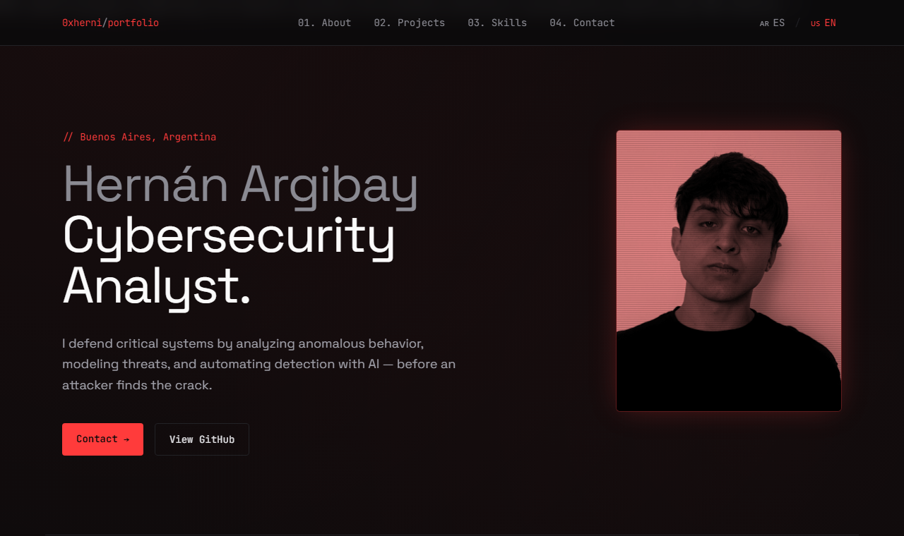

# 0xherni — Portfolio

🔗 **https://0xherni.github.io**

**English** · [Español](#español)

Personal portfolio of Hernán Argibay, Cybersecurity Analyst based in Buenos Aires.

## About the site
- Static site, no frameworks or build step: HTML + Tailwind CSS (CDN) + vanilla JS.
- Bilingual (EN / ES) with a language switcher.
- Dark theme with a terminal aesthetic.
- Case studies: Anomaly Detection API and MCP / AI Security.

---

## Español

Portfolio personal de Hernán Argibay, Cybersecurity Analyst en Buenos Aires.

### Sobre el sitio
- Sitio estático, sin frameworks ni build step: HTML + Tailwind CSS (CDN) + JS vanilla.
- Bilingüe (ES / EN) con selector de idioma.
- Dark theme con estética de terminal.
- Casos de estudio: Anomaly Detection API y MCP / AI Security.
