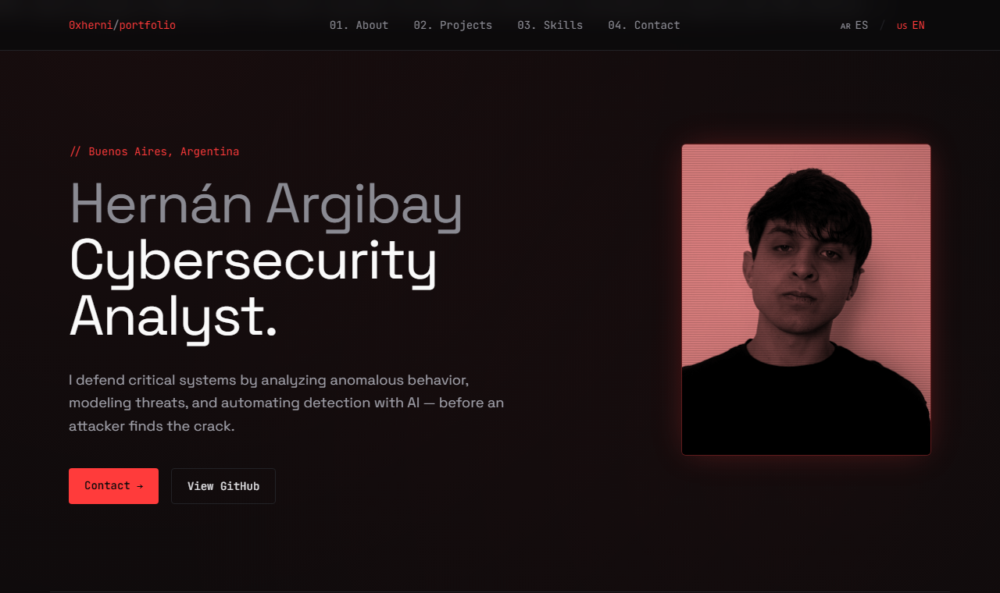

# 0xherni — Portfolio

🔗 **https://0xherni.github.io**

Personal portfolio of Hernán Argibay, Cybersecurity Analyst based in Buenos Aires.

## About the site
- Static site, no frameworks: HTML + Tailwind CSS + vanilla JS.
- Tailwind is compiled to `assets/css/tailwind.css` (committed). After changing classes, run `npm install` once and then `npm run build:css` (or `npm run watch:css` while editing).
- Share images (Open Graph) live in `assets/img/og/` and are generated from `tools/og-template.html` with `bash tools/build-og.sh`.
- Cookieless analytics via GoatCounter.
- Bilingual (EN / ES) with a language switcher.
- Dark theme with a terminal aesthetic.
- Case studies: Anomaly Detection API and MCP / AI Security.
